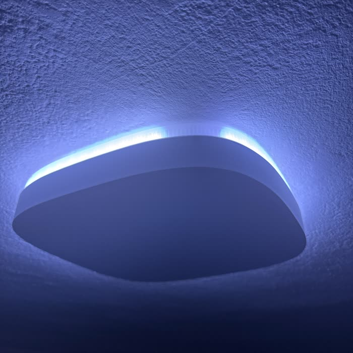
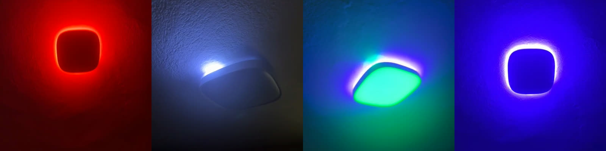

<p align="center">
  
</p>

<h1 align="center">Govee Ring for Home Assistant</h1>

<p align="center">
  Control the ring of a Govee H60A4 ceiling light separately from its main panel, locally.
  <br>
  <sub>Tested only on the H60A4. Support for other models needs pull requests.</sub>
</p>

<p align="center">
  <a href="https://github.com/raulpetruta/ha-govee-ring/releases"></a>
  <a href="https://github.com/raulpetruta/ha-govee-ring/actions/workflows/validate.yml"></a>
  <a href="https://github.com/raulpetruta/ha-govee-ring/actions/workflows/tests.yml"></a>
  <a href="https://hacs.xyz"></a>
</p>

---

The Govee H60A4 has a white panel with an RGB ring around it. The Govee Home app can light the ring alone. Home Assistant's built-in Govee Lights Local and Matter integrations expose one light, so any colour you pick lights the whole lamp.

This integration adds a Ring light next to the lamp's Main light on the same device:

| Entity | What it does |
|---|---|
| `light.<name>_ring` | Lights only the ring, in any colour and brightness. The panel stays dark. |
| `light.<name>_main_light` | Mirrors your existing Govee entity. After a ring session it brings the white back. |

Commands go straight to the light over your network. There is no Govee account and no cloud.

## Requirements

- A Govee H60A4. It was tested on BLE firmware 1.04.03 and Wi-Fi firmware 1.00.29. If you have another model, try it and open a PR with what you find.
- LAN Control turned on for the light in the Govee Home app (device settings, then LAN Control).
- A fixed IP address for the light. Set a DHCP reservation in your router.
- Home Assistant 2026.3 or newer. It was tested on 2026.9 and 2026.10.
- Optional: the built-in Govee Lights Local integration. Its entity becomes the Main light.

## Installation

The steps are the same on Home Assistant OS, Supervised, Container (Docker) and Core.

### HACS

1. In HACS, open the menu and choose Custom repositories.
2. Add `https://github.com/raulpetruta/ha-govee-ring` as an Integration.
3. Search for Govee Ring and select Download.
4. Restart Home Assistant.

### Marketplace (Home Assistant 2026.11 and newer)

Home Assistant 2026.11 replaces HACS with a built-in Marketplace ([core PR #183502](https://github.com/home-assistant/core/pull/183502), [docs PR #48513](https://github.com/home-assistant/home-assistant.io/pull/48513)).

1. Go to Settings, then Marketplace, then Add from link, and paste `raulpetruta/ha-govee-ring`. The Marketplace asks you to connect a GitHub account. It checks for updates every 48 hours.
2. Restart Home Assistant.

Once Govee Ring is in the default catalog, it appears in Marketplace search, and you no longer need a GitHub account to install or update it.

[](https://my.home-assistant.io/redirect/hacs_repository/?owner=raulpetruta&repository=ha-govee-ring&category=integration)

### Manual

1. Download `govee_ring.zip` from the [latest release](https://github.com/raulpetruta/ha-govee-ring/releases/latest).
2. Unzip it into `config/custom_components/govee_ring/`. On HAOS or Supervised, use the Samba share, Studio Code Server or File editor add-on. On Docker, use the folder you mounted as `/config`.
3. Restart Home Assistant.

Docker note: Home Assistant sends commands to the light over UDP port 4003, and bridge networking is enough for that. Govee Lights Local needs `network_mode: host` for discovery, so if you use it you probably run in host mode already.

## Setup

Go to Settings, then Devices & services, then Add integration, and choose Govee Ring. The form asks for:

- IP address or hostname of the light, for example `192.168.1.229`.
- Name, for example `Living Room`. The entities become `light.living_room_ring` and `light.living_room_main_light`.
- Main light entity, optional. Pick the existing light entity for this lamp, for example `light.h60a4_4`.

Add one entry per lamp. To change the IP address later, open the entry menu and choose Reconfigure. To change or remove the Main light, choose Configure.

## Usage

Use the two lights like any other light, in dashboards, scenes, automations and voice commands.

```yaml
# Soft purple on the ring, panel off
action: light.turn_on
target:
  entity_id: light.living_room_ring
data:
  rgb_color: [160, 0, 255]
  brightness_pct: 60
```

The `govee_ring.set_segments` action colours individual ring zones. The ring has 19 zones, numbered 0 to 18, and neighbouring zones blend into each other.

```yaml
# Red to blue gradient across the whole ring
action: govee_ring.set_segments
target:
  entity_id: light.living_room_ring
data:
  gradient: [[255, 0, 0], [0, 0, 255]]

# Zones 0 to 4 in green at half brightness
action: govee_ring.set_segments
target:
  entity_id: light.living_room_ring
data:
  segments: [0, 1, 2, 3, 4]
  rgb_color: [0, 255, 0]
  brightness_pct: 50
```

## How it works

The H60A4 accepts Govee's DreamView ("razer") streaming mode on the LAN API. When you turn the Ring on, the integration:

1. Sets the lamp to black RGB, which switches the white panel LEDs off, and then powers it on. The other order makes the panel flash.
2. Enables streaming and sends a 20-zone frame. Zones 0 to 18 are the ring. Zone 19 drives the panel, so it is always sent black.
3. Sends the frame again every 25 seconds. The lamp leaves streaming mode about 60 seconds after the last frame.

When you turn the Main light on after a ring session, the integration stops streaming and restores the last white colour temperature. The lamp never reports whether it is streaming, so the Ring entity uses assumed state.

## Known limitations



- A short section at the top of the ring stays dark. The firmware ties that part of the ring to zone 19, the same zone as the panel, so over the local API it can't light without lighting the panel too. The Govee cloud API has a per-segment command that might work, but it needs the cloud. Ideas are welcome.
- The Ring entity doesn't notice changes made from the Govee app or another controller.
- Don't stream from the Govee app's DreamView or another DreamView source at the same time.
- Setup doesn't test the connection. The light replies on UDP port 4002, which Govee Lights Local already uses.

<br clear="right">

## Troubleshooting

- Nothing happens. Check that LAN Control is on and the IP address is right, and that Home Assistant can reach the light (`ping <ip>` from the host).
- The panel lights up with the ring. Turn the Ring off and on again. If it keeps happening, open an issue with a short video.
- For diagnostics, open the entry menu and choose Download diagnostics. The IP address is redacted.
- For debug logs, add this to `configuration.yaml`:

  ```yaml
  logger:
    logs:
      custom_components.govee_ring: debug
  ```

## How the protocol was found

I asked Claude to make the ring controllable from Home Assistant. It couldn't see my ceiling, so it sent test patterns to the lamp and asked me to record a video. It pulled frames out of each clip, worked out which zone was which, and kept changing the protocol until the ring lit on its own.

<p align="center">
  
  <br>
  <sub>Frames from my phone videos. From left: the red marker that shows where the test starts, one zone lit during the zone sweep, zone 19 lighting the panel and the top of the ring in green, and the finished ring.</sub>
</p>

It asked for a 5-second red flash at the start of each test so it could match its commands to my recording. I didn't read a packet dump or open a debugger. I pointed my phone at the ceiling and sent the clip back, and I was amazed that it worked.

I think this changes how this kind of work gets done: you record the problem and the agent reverse-engineers it for you.

## Built with

- [Claude Code](https://claude.com/claude-code). Claude Opus 5.5 planned each step and Claude Sonnet 5.5 implemented it. That covers the protocol research, the tests, the integration and this release.
- [REA](https://github.com/morluto/rea), a reverse-engineering toolkit with a CLI and an MCP server. Claude used it to read the Govee Android app and find how the app talks to the lamp.
- The [SignalRGB](https://signalrgb.com) Govee plugin and the [OpenRGB](https://openrgb.org) community, whose notes showed that the H60A4 supports DreamView streaming.

## Disclaimer

This project is not affiliated with or endorsed by Govee. Govee and product names are trademarks of their owners. The LAN protocol was worked out by watching how the lamp behaves, and the repository contains no Govee code or assets. Use it at your own risk.

## License

[MIT](LICENSE)
